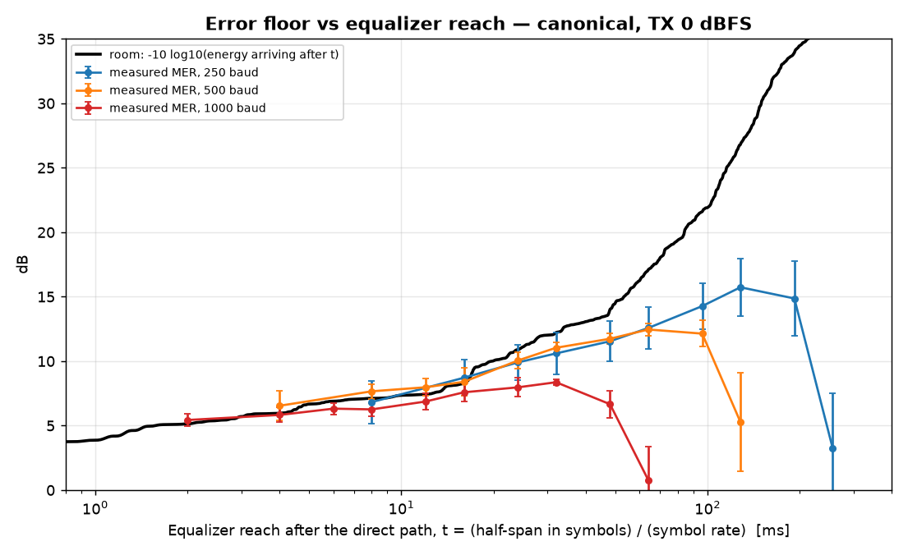

# acoustic-error-budget

**Where does the error come from?** This repository measures it on a real link: a laptop speaker and microphone, every transmitted bit known. The error of each received constellation is decomposed into its physical causes, and the error floor is shown to follow the room's energy-decay curve read at the equalizer's reach.

## Main findings (one room, 280+ captures)
- **The link is ISI-limited, not noise-limited.** At high TX level, background SNR is 34–38 dB, but MER is only 14 / 11.7 / 7.5 dB at 250 / 500 / 1000 baud. Noise is ≤4% of the error power.
- **The error floor follows the room's energy-decay curve read at the equalizer's reach.** All symbol rates fall on the same curve, within about 1 dB, for reaches up to 16 ms (figure below).
- **The reach is limited by the training preamble.** Going from a 127- to a 511-symbol preamble raises the best MER at 1000 baud from 8.4 to 15.4 dB, and cuts 16-QAM symbol errors from 37% to 1.7%, at the cost of 46% frame overhead instead of 17%.
- The error-budget decomposition is validated on synthetic data: each impairment is recovered within 0.3 dB when present alone.

Dataset description: [`DATASET_README.md`](DATASET_README.md)

**Data:** [doi:10.5281/zenodo.23343762](https://doi.org/10.5281/zenodo.23343762) (Zenodo, CC BY 4.0)



## Quick start
```bash
pip install -r requirements.txt
python collect.py --sim --label sim_room           # no hardware: simulated room channel
python analyze.py data --out results               # receiver + error budget for every capture
python validate_budget.py --out results/validation # validation of the decomposition on synthetic data
```
With real audio hardware (Windows example; list devices with `python collect.py --list-devices`):
```bash
python collect.py --label myroom --rs 250 1000 --mods QPSK 16QAM --levels 0 -6 \
  --in-dev "Microphone Array Realtek MME" --out-dev "Speakers Realtek MME" --notes "describe the room"
```
**Turn off all microphone and speaker "audio enhancements"** first. Echo cancellation erases the signal within about a second.

## What each script does
| Script | Purpose |
|---|---|
| `collect.py` | Plays known frames and records them, or uses `--sim`. Saves SigMF. Options: symbol rates, modulations, TX levels, preamble length (127–1023), lead-in and gap lengths |
| `analyze.py` | Receiver (sync, CFO, T/2 LS+LMS equalizer, PLL) → EVM, MER, SNR, SER, BER and an 8-part error budget per capture → `metrics.csv`, figures, `symbols.npz` |
| `compare.py` | Side-by-side comparison of recording conditions |
| `geometry.py` | Impulse response and decay from the recordings; ideal (MMSE) equalizer bound vs measured MER |
| `span_sweep.py` | Re-runs the receiver with different equalizer lengths: MER vs equalizer reach, overlaid on the room's energy-decay curve |
| `compare_reach.py` | Overlays the reach results of several conditions |
| `validate_budget.py` | Validates the decomposition on synthetic data with known impairments |
| `train_nrx.py` | Neural receiver vs classical receiver on the same symbols (PyTorch) |

`acomm/` holds the library: `modem.py` (waveforms), `receiver.py`, `analysis.py` (metrics and decomposition), `io_sigmf.py`, `channel_sim.py`, `plots.py`, `features.py`.

## Data format
Each capture is `<name>.sigmf-data` (float32 little-endian mono audio, 48 kHz) plus `<name>.sigmf-meta` (JSON). Everything needed to regenerate the transmitted bits is stored under the `acomm:` keys: modulation, symbol rate, TX level, seed, preamble length, frame and gap timing, label, free-text notes.

## Citation
See [`CITATION.cff`](CITATION.cff). Dataset: E. Al Rabby, *Known-bit acoustic link dataset: error-budget decomposition of a real reverberant channel*, Zenodo, 2026. doi:10.5281/zenodo.23343762

## License
Code: MIT ([`LICENSE`](LICENSE)). Data: CC BY 4.0.
